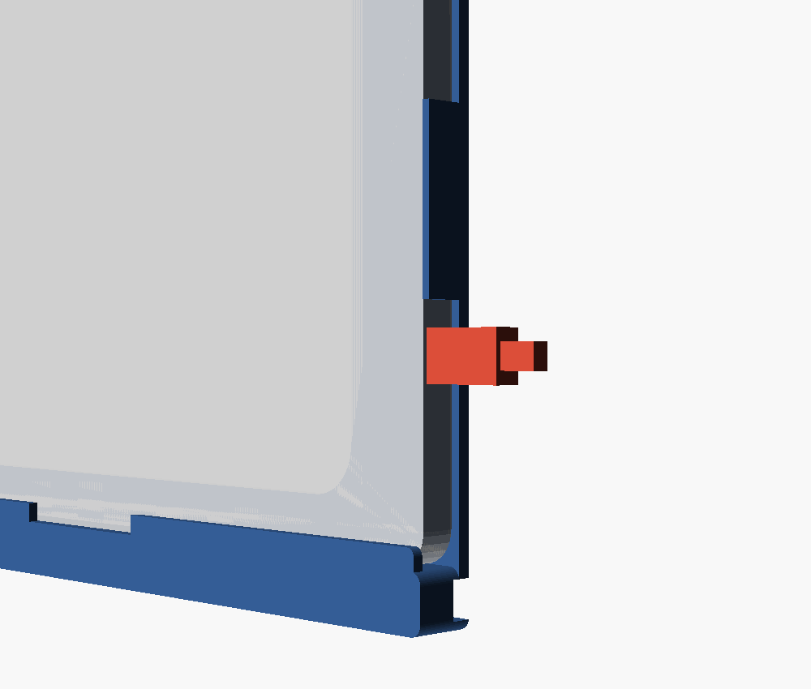
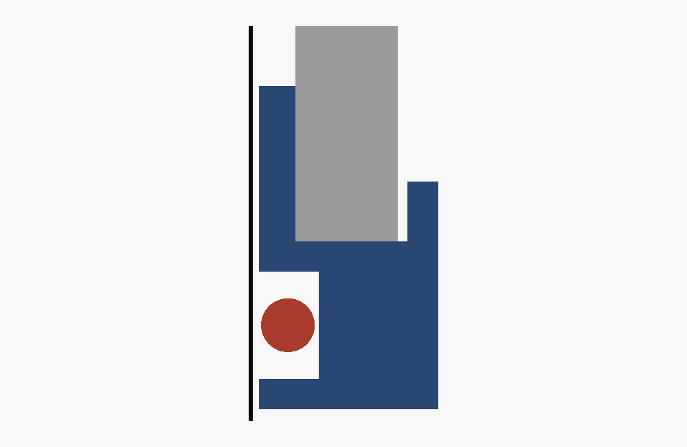

# Fire HD 10 — Landscape Wall Mount

A simple, flat-backed **landscape wall mount** for the **Amazon Fire HD 10 (2023 / 13th generation)**,
designed to be hung with **Command 20 lb X-Large Picture Hanging Strips**. Built for running a
Home Assistant wall panel.


## Design goals

- **Flat back** — a smooth, rigid panel so the Command strips get full, even contact.
- **USB, power and volume stay clear** — they all live on one short edge of this tablet (the
  right edge here, with the camera at the top). On that edge the only part touching the tablet is a
  slim rail placed **between** the measured USB-C plug and the buttons.
- **Open lay-in cable groove** — the charge cable *drops into* an open groove on the **back** of the
  base (no threading, no bridged tabs): in from the USB edge, across behind the tablet, out the
  **bottom-left** and down the wall. The wall caps the groove when mounted; nothing crosses the front.
- **Seats flush at the bottom** — the tablet's **rounded corners** drop into open relief (no square
  brackets fighting the radius), so the bottom edge sits flat on the shelf. Two slim **side rails**
  on the frame stop it sliding sideways by catching the straight side edges.
- **Recessed Command-strip pads** — two shallow 1.5 mm pockets on the back, 25 mm wide for the
  22.4 mm XL strips, let the strips sit inset so the mount hangs a little closer to the wall.
- **Tool-free "lift & drop" retention** — no flexing clips to fatigue or snap. Only 12 mm of frame
  above the tablet: just enough room to lift it 7 mm over the 5 mm bottom lip.
- **Squared, flush look** — straight (un-beveled) front edges, straight-walled groove, minimal
  corner rounding.
- **Fits a 256 × 256 mm bed** — the part is 250.8 mm wide, inside a Bambu P1S/P2S/X1 plate (≈5 mm
  of margin to the edge).

## How it holds the tablet

```
  FRONT view                            │ USB edge: power / volume / USB-C
          ┌───[clip]───────[clip]───┐   │  cable plugs in, runs down this edge
        [rail]                          │
  open ►  │         (window)        │ [rail]
  edge    │                         │   │
          │                         │   │   (cable groove is on the BACK)
          └─────────[ notch ]───────┘   │
           ╚══════════════════════◁═╝   ← open groove across the back of the base
              ▼ exits bottom-left, behind the mount, down the wall
```

- **Bottom shelf + front lip** carries the tablet's weight; a center **finger notch** lets you push
  the tablet up and out with a thumb. The bottom corners drop into open relief, so the tablet seats
  flat instead of perching on square stops.
- **Two top clips** hold the top edge flat against the panel.
- **Two slim side rails** catch the tablet's straight side edges to stop sideways slide. They sit
  mid-edge, 58–98 mm above the tablet's bottom edge. That is clear of the rounded corners, above
  the USB-C plug (40–52 mm) and below the buttons (from ~106 mm).



### Cable routing

The groove is **open** — you just lay the cable in, no threading. It sits on the **back of the base**
(the wall side), so nothing is visible across the front. Mount the tablet with its **USB edge on the
right**, plug in, and press the cable into the groove: it runs in from the right edge, across behind
the tablet, and **exits at the bottom-left**, already against the wall, so it drops straight down.

It's a plain open channel (9 mm wide × 5 mm deep) — deliberately oversized so the cable is a loose,
forgiving fit. The opening is the full width on the back face; the **wall caps it** once the mount is
hung. It only cuts into the thick bottom base (the Command strips mount higher on the side borders),
so the strip pads and the rest of the back stay flat. Fits a typical ~4–5 mm USB-C cable. Want the cable
to exit bottom-right instead? Mirror the part in your slicer. Everything except the channel is
symmetric.


Cross-section through the channel — a true slice of the STL (blue), with reference overlays: black =
the wall, grey = the tablet, red = a cable. The channel is **open to the wall**, the **front is solid
cover**, and the bottom lip grows straight out of the base in front of the tablet's bottom edge:



### Inserting / removing

1. Tilt the top edge in **under the two top clips**.
2. Lift the tablet up ~7 mm (there's room above), then **drop the bottom edge in behind the shelf lip**.
3. To remove: lift up until the bottom edge clears the lip, swing the bottom out, lower away from the clips.

## Mounting with Command strips

1. Clean the wall and the **flat back of the mount** with isopropyl alcohol; let dry.
2. Use **2 pairs of Command 20 lb XL strips**, one pair per side. The back has **two recessed
   pads** (one down each side border), 25 × 150 mm for the 22.4 mm-wide strips. A strip plus its
   tab is about 122 mm, so one fits per pad with the tab pointing down. Seat the strips in the
   pockets so the mount hangs closer to the wall. Two pairs are half a pack's 20 lb rating, far
   above the load (mount ≈ 69 g + tablet ≈ 434 g ≈ 0.5 kg total).
3. Snap the strip pairs together, press the mount to the wall, hold firmly, then follow the Command
   instructions (press 30 s, remove, wait 1 h before loading).
4. Insert the tablet, then plug the cable into the open edge and route it through the channel.


> The printed **first layer (the back face) is the flat side** — print it back-down (see below) and the
> back comes out smooth and ideal for the adhesive strips.

## Printing (Bambu Lab, Bambu Studio)

Import `3mf/fire_hd10_mount.3mf` (or `stl/fire_hd10_mount.stl`) into Bambu Studio.

| Setting            | Recommendation                                                        |
|--------------------|-----------------------------------------------------------------------|
| **Orientation**    | **Back panel flat on the plate** (lips/clips pointing up).            |
| **Material**       | PLA is fine indoors. **PETG** if the panel may sit in direct sun/heat.|
| **Supports**       | **On, and turn OFF "On build plate only."** The 3 front lips (bottom lip + 2 top clips) overhang the tablet pocket, and the surface under them is the back plate, not the build plate, so their supports must stand *on the part*. With "build plate only" they get no support at all and print as drooping cantilevers. Tree (auto) is a good choice; the supports sit inside the tablet pocket and snap out. The cable-channel roof (~9 mm) and shallow strip-recess floors are short bridges; if the slicer also drops support into the back channel, it's optional (block it or pull it out). |
| **Walls / infill** | 3 walls, 15–20 % infill. Plenty strong for ~0.5 kg in shear.         |
| **Layer height**   | 0.2 mm.                                                               |

Approx. part: **250.8 × 190.8 × 15 mm**, ~99 cm³ solid, **~69 g PLA** at ~15–20 % infill, a few hours.
(Supports on with "On build plate only" off — unsupported front lips are what failed the first print.)

## Files

| Path                           | What                                               |
|--------------------------------|----------------------------------------------------|
| `src/fire_hd10_mount.scad`     | Parametric OpenSCAD source (all dimensions here).  |
| `stl/fire_hd10_mount.stl`      | Ready-to-slice mesh.                               |
| `3mf/fire_hd10_mount.3mf`      | Ready-to-slice mesh (3MF).                         |
| `tools/`                       | STL→3MF converter and a mesh check (shell count).  |
| `images/`                      | Renders (made by importing the STL).               |

## Customizing

All dimensions are parameters at the top of the `.scad` file (tablet size, clearances, lip depths,
etc.). To regenerate after editing:

```bash
openscad -o stl/fire_hd10_mount.stl src/fire_hd10_mount.scad
python3 tools/check_mesh.py stl/fire_hd10_mount.stl     # must report "shells: 1"
python3 tools/stl_to_3mf.py stl/fire_hd10_mount.stl 3mf/fire_hd10_mount.3mf
```

`check_mesh.py` catches parts that are manifold but split into separate bodies (a floating lip, say),
which "manifold / NoError" alone does not.

> **Note:** the 3MF is produced from the STL with `tools/stl_to_3mf.py`, **not** `openscad -o …3mf`
> (OpenSCAD's native 3MF embeds base-materials + newer schema namespaces).
>
> Bambu Studio shows *"invalid config, loading geometry only"* when importing **any** 3MF not saved
> as a Bambu project — it's a harmless notice, and the geometry loads normally. **Import the STL**
> (`stl/fire_hd10_mount.stl`) if you'd rather not see it; the geometry is identical.

**Fit too tight or too loose?** Adjust `cl_t` (thickness clearance) and `cl_w` (width clearance).
**Rail in the way of a port or button?** Set `usb_y0` / `usb_y1` (the plug body) and `btn_y0`
(where the buttons start), all measured from the tablet's bottom edge. The rails place themselves
between the plug and the buttons, 6 mm clear of each.
**Want even less space above the tablet?** `lift` must stay at least 2 mm more than `bl_cover` (the
bottom lip). The file asserts this. Shrink both together.
**Different generation or a case?** Change `tw` / `th` / `tt` to the outer dimensions you measure.

## Tablet reference (2023 / 13th gen)

- Dimensions: **246 × 164.8 × 8.6 mm** · ~434 g
- Power, volume, USB-C (and headphone jack) are all on **one short edge**: the right edge when the
  front camera is at the top.
- Measured on a real unit, from the tablet's bottom edge: the USB-C plug body (12 mm wide) spans
  **40–52 mm**, and the buttons start at **~106 mm**. The USB-C plug sticks out ~29 mm, including
  its strain relief, before the cable can bend. A 90° USB-C cable makes a tidier drop into the
  channel.

Sources: [device specs](https://www.devicespecifications.com/en/model/d20936bf) ·
[button/port layout](https://www.techradar.com/tablets/amazon-fire-hd-10-2023-review-only-smouldering)
