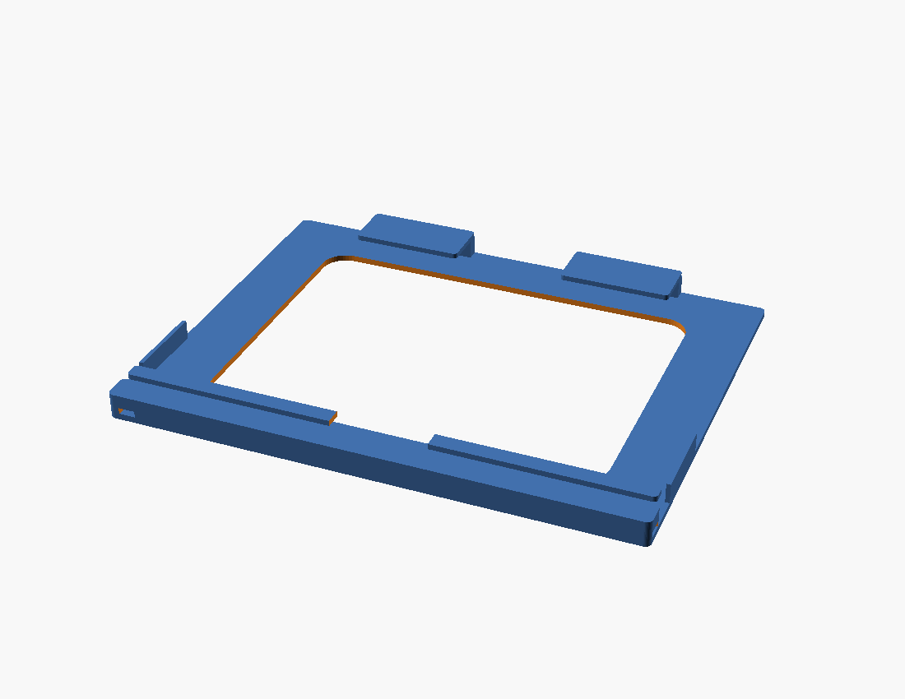
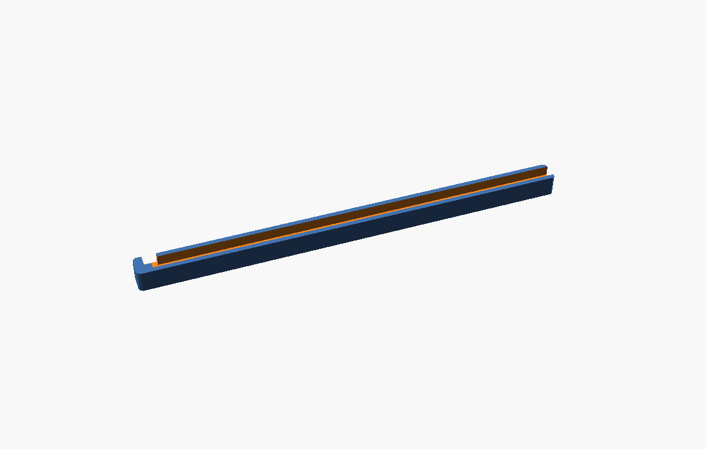
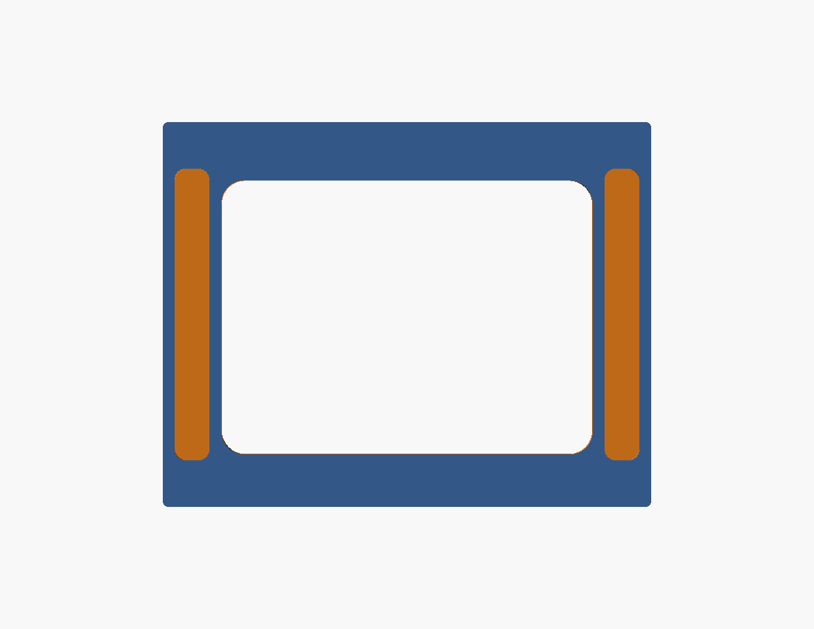

# Fire HD 10 — Landscape Wall Mount

A simple, flat-backed **landscape wall mount** for the **Amazon Fire HD 10 (2023 / 13th generation)**,
designed to be hung with **Command 20 lb X-Large Picture Hanging Strips**. Built for running a
Home Assistant wall panel.



## Design goals

- **Flat back** — a smooth, rigid panel so the Command strips get full, even contact.
- **Both short edges fully open** — the USB-C port, power button and volume rocker all live on a
  single short edge of this tablet, so leaving both short edges open keeps **USB, power and volume
  accessible** no matter which way you orient it.
- **Open lay-in cable groove** — the charge cable *drops into* an open groove on the **back** of the
  base (no threading, no bridged tabs): in from the USB edge, across behind the tablet, out the
  **bottom-left** and down the wall. The wall caps the groove when mounted; nothing crosses the front.
- **Seats flush at the bottom** — the tablet's **rounded corners** drop into open relief (no square
  brackets fighting the radius), so the bottom edge sits flat on the shelf. Two slim **side rails**
  on the frame stop it sliding sideways by catching the straight side edges.
- **Recessed Command-strip pads** — two shallow 1.5 mm pockets on the back let the strips sit inset,
  so the mount hangs a little closer to the wall.
- **Tool-free "lift & drop" retention** — no flexing clips to fatigue or snap.
- **Squared, flush look** — straight (un-beveled) front edges, straight-walled groove, minimal
  corner rounding.
- **Fits a 256 × 256 mm bed** — the part is 250.8 mm wide, inside a Bambu P1S/P2S/X1 plate (≈5 mm
  of margin to the edge).

## How it holds the tablet

```
  FRONT view                            │ USB edge: power / volume / USB-C
          ┌───[clip]───────[clip]───┐   │  cable plugs in, runs down this edge
        [rail]                          │
  open ►  │         (window)        │ [rail]
  edge    │                         │   │
          │                         │   │   (cable groove is on the BACK)
          └─────────[ notch ]───────┘   │
           ╚══════════════════════◁═╝   ← open groove across the back of the base
              ▼ exits bottom-left, behind the mount, down the wall
```

- **Bottom shelf + front lip** carries the tablet's weight; a center **finger notch** lets you push
  the tablet up and out with a thumb. The bottom corners drop into open relief, so the tablet seats
  flat instead of perching on square stops.
- **Two top clips** hold the top edge flat against the panel.
- **Two slim side rails** catch the tablet's straight side edges to stop sideways slide. They start
  above the corner radius, so the rounded corners stay clear.

### Cable routing

The groove is **open** — you just lay the cable in, no threading. It sits on the **back of the base**
(the wall side), so nothing is visible across the front. Mount the tablet with its **USB edge on the
right**, plug in, and press the cable into the groove: it runs in from the right edge, across behind
the tablet, and **exits at the bottom-left**, already against the wall, so it drops straight down.

Because the groove is open along its whole length, there's nothing to bridge and no tabs to fight —
the **wall itself caps it** once the mount is hung, holding the cable in. It only cuts into the thick
bottom base (the Command strips mount higher on the side borders), so the strip pads and the rest of
the back stay flat. Fits a typical ~4–5 mm USB-C cable. Prefer the USB edge on the left? Mirror the
part in your slicer — both short edges are open.



### Inserting / removing

1. Tilt the top edge in **under the two top clips**.
2. Lift the tablet up ~11 mm (there's room above), then **drop the bottom edge in behind the shelf lip**.
3. To remove: lift up until the bottom edge clears the lip, swing the bottom out, lower away from the clips.

## Mounting with Command strips

1. Clean the wall and the **flat back of the mount** with isopropyl alcohol; let dry.
2. Use **4× Command 20 lb XL strips** — the back has **two recessed pads** (one down each side border)
   sized for them; seat the strips in those pockets so the mount hangs closer to the wall. This stays
   well within the 20 lb / strip rating (mount ≈ 74 g + tablet ≈ 434 g ≈ 0.5 kg total).
3. Snap the strip pairs together, press the mount to the wall, hold firmly, then follow the Command
   instructions (press 30 s, remove, wait 1 h before loading).
4. Insert the tablet, then plug the cable into the open edge and route it through the channel.



> The printed **first layer (the back face) is the flat side** — print it back-down (see below) and the
> back comes out smooth and ideal for the adhesive strips.

## Printing (Bambu Lab, Bambu Studio)

Import `3mf/fire_hd10_mount.3mf` (or `stl/fire_hd10_mount.stl`) into Bambu Studio.

| Setting            | Recommendation                                                        |
|--------------------|-----------------------------------------------------------------------|
| **Orientation**    | **Back panel flat on the plate** (lips/clips pointing up).            |
| **Material**       | PLA is fine indoors. **PETG** if the panel may sit in direct sun/heat.|
| **Supports**       | **On** — the only overhangs are the undersides of the 3 front lips (shelf lip + 2 top clips). "Support on build plate only" is enough. The side rails are vertical walls, the **open cable groove needs no bridging**, and the shallow strip-recess floors self-bridge. |
| **Walls / infill** | 3 walls, 15–20 % infill. Plenty strong for ~0.5 kg in shear.         |
| **Layer height**   | 0.2 mm.                                                               |

Approx. part: **250.8 × 197.8 × 15 mm**, ~107 cm³ solid, **~74 g PLA** at ~15–20 % infill, a few hours.
(Don't forget to enable supports — a missing front lip is what failed the first print.)

## Files

| Path                           | What                                               |
|--------------------------------|----------------------------------------------------|
| `src/fire_hd10_mount.scad`     | Parametric OpenSCAD source (all dimensions here).  |
| `stl/fire_hd10_mount.stl`      | Ready-to-slice mesh.                               |
| `3mf/fire_hd10_mount.3mf`      | Ready-to-slice mesh (3MF).                         |
| `images/`                      | Renders.                                           |

## Customizing

All dimensions are parameters at the top of the `.scad` file (tablet size, clearances, lip depths,
etc.). To regenerate after editing:

```bash
openscad -o stl/fire_hd10_mount.stl src/fire_hd10_mount.scad
python3 tools/stl_to_3mf.py stl/fire_hd10_mount.stl 3mf/fire_hd10_mount.3mf
```

> **Note:** the 3MF is produced from the STL with `tools/stl_to_3mf.py`, **not** `openscad -o …3mf`
> (OpenSCAD's native 3MF embeds base-materials + newer schema namespaces).
>
> Bambu Studio shows *"invalid config, loading geometry only"* when importing **any** 3MF not saved
> as a Bambu project — it's a harmless notice, and the geometry loads normally. **Import the STL**
> (`stl/fire_hd10_mount.stl`) if you'd rather not see it; the geometry is identical.

**Fit too tight or too loose?** Adjust `cl_t` (thickness clearance) and `cl_w` (width clearance).
**Bottom corners catching?** The side rails start at `rail_y0`; `t_r` is the assumed tablet corner
radius (rails clear it). Raise `t_r` / `rail_y0` if your corners are rounder than ~12 mm.
**Different generation or a case?** Change `tw` / `th` / `tt` to the outer dimensions you measure.

## Tablet reference (2023 / 13th gen)

- Dimensions: **246 × 164.8 × 8.6 mm** · ~434 g
- Power, volume, USB-C (and headphone jack) are all on **one short edge** — the open side in this mount.

Sources: [device specs](https://www.devicespecifications.com/en/model/d20936bf) ·
[button/port layout](https://www.techradar.com/tablets/amazon-fire-hd-10-2023-review-only-smouldering)
